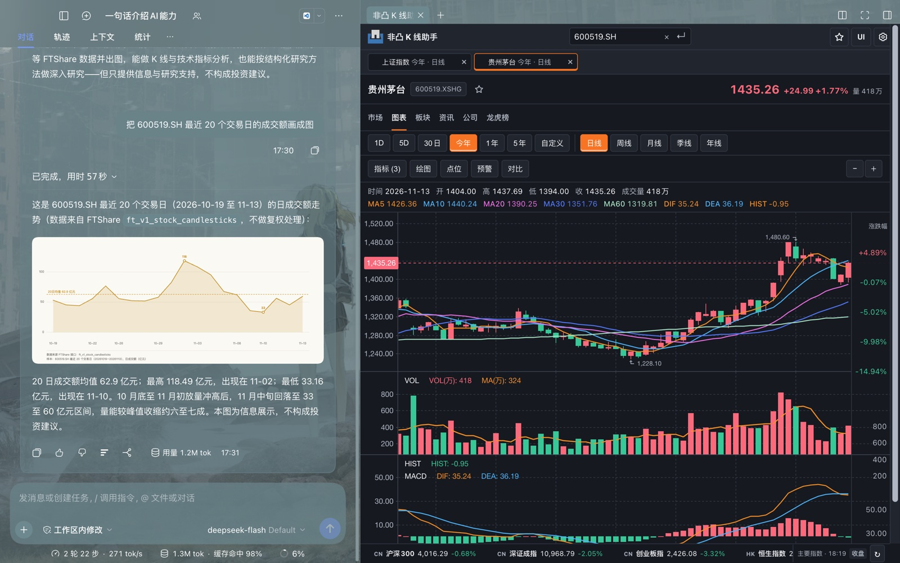

# dsh-fft-bundle

[](https://www.npmjs.com/package/@dsh-ft/finance-all-in-one)
[](packages/dsh-fft-bundle/LICENSE)

一次安装，把 DeepSeek Harness 组装成一座金融工作台：FTShare 数据面、K 线图表、出图技能、A 股 / 商品期货模拟盘。



产品页见 [`packages/dsh-fft-bundle/README.md`](packages/dsh-fft-bundle/README.md)（npm 上展示的就是它）；对外变更记录见
[CHANGELOG.md](CHANGELOG.md)。

本仓是 pnpm workspace：`packages/*` 是各个插件，组合包 `@dsh-ft/finance-all-in-one` 是终端用户的安装入口。

## 两条产物线的区别

| | 公共 npm（对外） | 自包含 tarball（本地） |
| --- | --- | --- |
| 安装方式 | `dsh plugin add @dsh-ft/finance-all-in-one` | 下载 `.tgz`，插件管理器贴绝对路径 |
| 依赖来源 | npm registry 解析 | 产物内已内联全部子插件 |
| 前置 | 能访问 npm | 无（免 ssh） |

两条线是同一个包、同一份清单、同一份公共 patch，**差异只有 `dsh.bundle.patch` 多一个文件**。

## 使用方式

### 方式一：npm（推荐）

```bash
dsh plugin add @dsh-ft/finance-all-in-one
```

也可以在「设置 → 插件管理 → 添加插件」里直接输入包名。装完重启一次应用，新会话默认就是金融模式。

### 方式二：tarball（装在没有 npm 的环境）

1. 取得 `dsh-ft-finance-all-in-one-X.Y.Z.tgz`：[Releases](https://github.com/FTShare-Lab/dsh-plugin-fft-bundle/releases) 页下载后保存好，或直接复制该资产的 URL；
2. 安装官方 Deepseek Harness 桌面版并启动：<https://deepseek-harness.github.io/deepseek-harness>
3. 「设置」→「插件管理」→「添加插件」，粘贴文件的**绝对路径**，或直接粘贴 Release 资产 URL（形如 `https://github.com/FTShare-Lab/dsh-plugin-fft-bundle/releases/download/vX.Y.Z/dsh-ft-finance-all-in-one-X.Y.Z.tgz`）：

```
/Users/<你>/Downloads/dsh-ft-finance-all-in-one-X.Y.Z.tgz
```

4. 装完刷新一次页面；若替换的是已装的同名插件，完全退出并重开应用。

文件里已内联全部子插件，这条路不需要 ssh，也不需要改 profile 的 pnpm 配置。升级时下载新版本文件
（文件名带版本号）再贴新路径即可；同一条路径重贴不会升级。

## 开发方式

```bash
pnpm install
pnpm build && pnpm test
```

用本地 link 或打包文件验证自己的改动（`dev` 不是安装来源）：

```bash
dsh plugin --profile <name> add link:./packages/dsh-fft-bundle
# 或
pnpm pack:tarball && dsh plugin --profile <name> add <输出的 .tgz 绝对路径>
```

改完要重新 build 并重启 `dsh web`（Host 代码不热载）。
推送前必须 `pnpm build` 并提交 `lib/`。
