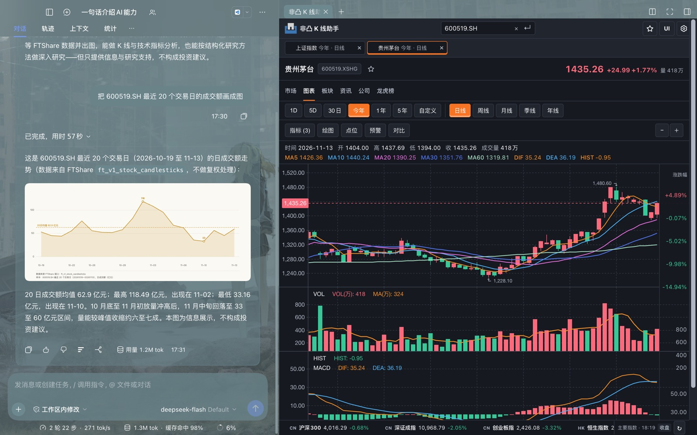

# FT 金融工作台：行情、K 线、模拟盘

中文 | [English](README.en.md)

[](https://www.npmjs.com/package/@dsh-ft/finance-all-in-one)
[](LICENSE)

一次安装，把 DeepSeek Harness 组装成一座金融工作台：FTShare 数据面、K 线图表、出图技能、 A 股 / 商品期货模拟盘。



> DSH ≥ 0.2.1-rc.2 · 装完新会话就是金融模式 · K 线随包携带 · 账本保存在本地

## 效果

模拟盘：下单前把成交价、佣金、印花税、过户费与剩余资金一次算清；右侧常驻 K 线，点图上的标的一键带回交易页。


K 线：多市场行情、均线与成交量，在原生侧栏里打开。


出图：分析结果可以直接出图，模型按技能里的规则选择合适的图型并附在回答后面。


## 装了什么

| 组件 | 作用 |
| --- | --- |
| 金融模式（`ft-finance`）预设 | 新会话的默认工作方式：金融人设、行情与取数工具、出图技能 |
| `@dsh-ft/dsh-fft-settings` | 设置页「金融终端」分区与 API Key 凭据 |
| `@dsh-ft/dsh-fft-ftshare` | FTShare 数据面工具：行情、板块、资金流、财务等 |
| `@ftshare-lab/dsh-kline` | K 线图表与侧栏，随包携带 |
| `@dsh-ft/dsh-fft-plot` | 出图技能：把取数结果渲染成内联 SVG |
| `@dsh-ft/dsh-fft-paper-trading` | 模拟盘：本地账本、下单、持仓与复盘 |

## 安装

在「设置 → 插件管理 → 添加插件」里输入包名：

```sh
dsh plugin add @dsh-ft/finance-all-in-one
```

装完重启一次应用。不需要改 pnpm 配置，也不需要 ssh：产物里已经带好依赖的 K 线。

- **不要**与同样自带 FTShare 数据服务的入口包（如 `@dsh-ft/dsh-fft-paper-trading`）同时安装：数据服务行会重复，插件管理器里相关项将无法单独开关。
- 完整 K 线视图依赖本机 Python 3.10+，首次启动会联网准备运行环境；准备失败不影响取数、出图、下单与复盘。

## 上手三步

1. **配置数据源（可选）**：DSH「设置 → 金融终端」里填 FTShare API Key，免费申请地址 <https://ftai.chat/me/profile?tab=api-key&utm_source=dsh-fft>，无 key 时使用匿名额度。
2. **新建会话**：默认就是金融模式，不用再选预设。
3. **直接问**：

   - 「贵州茅台最近走势怎么样？」
   - 「今天涨停集中在哪些板块？」
   - 「把近 20 个交易日的成交额画出来」

## 能力范围

- **模拟盘**：A 股与商品期货（日盘），本地账本，支持批量建仓、挂单撤单、复盘与风控。
- **K 线**：多市场行情、技术指标与支撑压力位，在侧栏打开。
- **出图**：把取数结果渲染成内联 SVG，图随回答一起显示。
- **数据**：行情、板块、资金流、财务报表等经 FTShare 数据面提供。

## 数据与隐私

- 模拟盘的账本保存在本机 DSH 数据目录（默认 `~/.dsh`）下的 `paper-trading/`，不上传任何服务器。
- 除了向 FTShare 发起行情与数据查询外，本插件不向外部发送数据，也不含遥测。
- 仅用于研究与模拟，不构成投资建议。

## 反馈

遇到 bug 或想加功能，走 GitHub Issues：

- [报告 bug](https://github.com/FTShare-Lab/dsh-plugin-fft-bundle/issues/new)
- [功能建议](https://github.com/FTShare-Lab/dsh-plugin-fft-bundle/issues/new)

贴日志前先删掉 API Key、账户数据与账本路径。

本项目以 [MIT](LICENSE) 许可开源。变更记录见 [CHANGELOG.md](https://github.com/FTShare-Lab/dsh-plugin-fft-bundle/blob/dev/CHANGELOG.md)。
