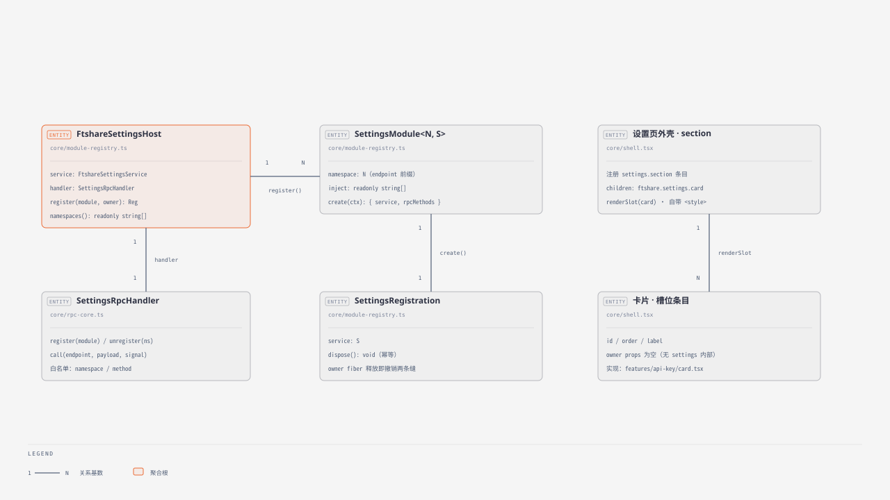
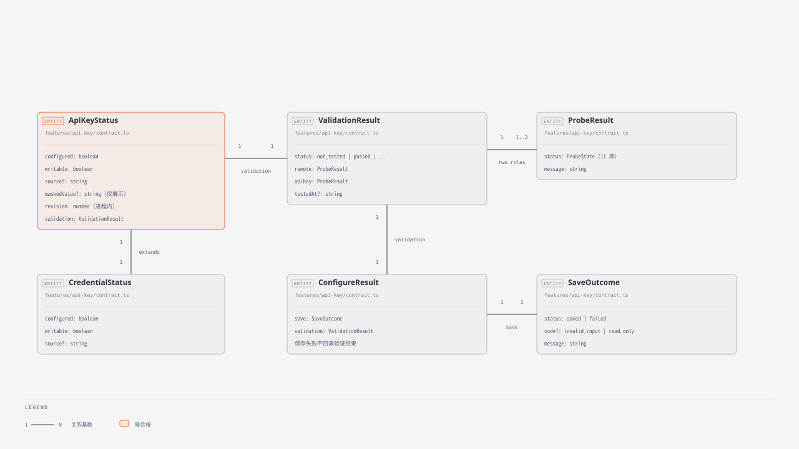

# FTShare Settings：共享设置、远端服务与 API Key 检测

`@ft/dsh-fft-settings`（原 `@ft/dsh-ftshare-settings`，迁移 dsh-fft-bundle 仓时改名）是 DSH 共享设置插件。Host 服务为 **`ctx.ftshareSettings`**，API Key 的所有能力位于 **`apiKey` 命名空间**；未来主题、用户偏好应作为 `theme`、`preferences` 等同级命名空间扩展，不能混入 `apiKey`。

当前只实现 API Key 管理、远端服务检查与 Key 验证，未实现主题／用户偏好的持久化接口，也不提供行情查询、图表、通用 SDK 代理或 Python 凭据桥。Key 由 DSH `credentials` 服务存储，本插件不保存第二份密钥文件。原未发布的 `ftshareCredentials` 草案已替换，不保留旧服务别名。

## 给开发者和 agent 的接入约定

- Host 消费者声明 `inject = ['ftshareSettings']`，通过 `ctx.ftshareSettings.apiKey` 调用；不要依赖插件排列顺序。
- 包名为 `@ft/dsh-fft-settings`（Host API 服务名 `ftshareSettings`、RPC 路由 `/api/ftshare-settings` 维持不变，旧消费者无需适配），bundle 入口仍为 `cordis.patch.yml`；设置页 ID 为 `dsh-fft`（显示名「非凸金融终端」，`order: 120`），旧 ID `ftshare` 不再注册。
- 包主入口导出 Host 类型；`/contract` 是浏览器安全的类型、常量和输入校验；`/client-api` 导出 `createApiKeyClient`。
- `apiVersion = 1`。新增设置领域应新增命名空间；破坏公开语义的修改需要重新评估协议版本。
- 本仓没有修改 dsh_kline。下面的 kline 代码是接入示例，不代表消费者已经完成适配。
- 不读取 `.credentials.yaml`、不解析 kline 的旧 JSON 文件、不把 Key 写入普通 settings 或 localStorage，不通过修改全局 `process.env` 同步运行中消费者。
- 设置页只有访问凭据一张卡；本插件不展示应用版本，也不提供检查更新入口。

## Host API v1

```ts
ctx.ftshareSettings.apiVersion // 1
const apiKey = ctx.ftshareSettings.apiKey
```

| 方法 | 返回与语义 |
| --- | --- |
| `describe()` | `Promise<ApiKeyStatus>`：`configured`、`writable`、`source?`、`maskedValue?`、进程内 `revision`、当前 `validation`；不返回完整密钥 |
| `resolve()` | `Promise<string \| undefined>`：每次解析当前 Key；仅限可信 Host 使用 |
| `set(value)` | `Promise<void>`：只保存，不联网测试；去首尾空白，拒绝空值、超过 512 字符和控制字符 |
| `clear()` | `Promise<void>`：只清除 DSH 保存值；可能露出 `.env` 回退值 |
| `configureAndTest(value)` | `Promise<ConfigureResult>`：先保存，再检查远端服务和 Key；保存和验证分别返回，测试失败不回滚 |
| `testConnection()` | `Promise<ValidationResult>`：先匿名检查远端，再验证调用时生效的 Key，不修改配置；无 Key 仍检查远端 |
| `getValidationStatus()` | `Promise<ValidationResult>`：读取最近验证结果，不联网 |
| `subscribe(listener)` | 返回取消订阅函数；失效通知，无参数、无密钥；回调重新读取状态 |
| `createEnvironment(base?)` | 返回新环境变量对象，用当前 Key 替换 `FTSHARE_API_KEY`；无 Key 删除该字段，不修改 base |

`resolve()` 与 `createEnvironment()` 的返回值包含秘密，禁止送到浏览器、模型工具结果、命令行参数或日志。`revision` 不是跨重启版本号，也不能用作持久化凭据标识。

### 配置与验证分开返回

```ts
const result = await apiKey.configureAndTest(userInput)
// 示例：保存成功，但 Key 未通过认证；远端服务正常
// {
//   save: { status: 'saved', message: '已保存到 DSH 凭据存储' },
//   validation: {
//     status: 'partial',
//     remote: { status: 'available', message: '远端服务正常' },
//     apiKey: { status: 'auth_failed', message: 'API Key 未通过认证' },
//     testedAt: '2026-09-16T00:00:00.000Z'
//   }
// }
```

- `save.status`：`saved` / `failed`。失败代码为 `invalid_input`、`read_only`、`save_failed`，保存失败不测试。
- `validation.status`：`not_tested` / `not_run` / `passed` / `partial` / `failed` / `superseded`。
- 分项状态：`available`、`auth_required`、`auth_failed`、`permission_denied`、`quota_exceeded`、`rate_limited`、`network_error`、`timeout`、`upstream_error`、`invalid_response`、`not_run`。
- `remote` 是远端服务结果，`apiKey` 是 Key 验证结果；`testedAt` 是本次探测起始时间。成功响应中的空数组也算通过，节假日或收盘不影响判定。
- 保存成功后，网络、权限或认证失败只影响 `validation`，不撤销 Key。若 RPC 中断而没有结果，客户端不能断言保存失败，应重新读取配置，再测试当前连接。
- 验证只保存在内存，重启后是“未测试”；不存储原始行情响应。

### 两项检测，最多两个请求

| 结果字段 | 检测目的 | 固定请求 | 是否携带 Key |
| --- | --- | --- | --- |
| `validation.remote` | 远端服务是否正常 | `GET https://market.ft.tech/gateway/api/v1/market/data/stock-candlesticks` | 不携带 |
| `validation.apiKey` | 当前 Key 是否通过认证 | `GET https://market.ft.tech/gateway/api/v2/market/data/stock_minutes` | 使用 `FTSHARE_API_KEY` 请求头 |

日 K 请求使用 `600519.SH`、day、不复权、最近 30 天、`limit=2`；历史分钟请求使用同一股票、1 分钟、不复权、最近 24 小时、`limit=1`。服务端实际限制为包含首尾的三个北京时间自然日，而非滚动 72 小时；24 小时最多覆盖两个自然日。`adjust_kind` 使用实测接受的小写 `none`；文档中的 `None` 会被实际接口以 HTTP 400 拒绝。参数固定，不查交易日历、不回溯补数据、不验证 OHLC 字段。

**成功条件是 HTTP 成功、业务 `code=200` 且 `data` 为数组；数组为空同样通过。** 本插件检查服务和认证结果，不检查行情数据完整性。HTTP 200 中的业务失败、错误响应结构不能当作成功。响应中的行情不公开返回、不持久化。

- 远端正常、Key 通过：`status=passed`；两项均为 `available`。
- 远端正常、Key 无效／未配置／受限：`status=partial`；`remote` 仍为 `available`，检查 `apiKey.status` 获取原因。不能把 `partial` 当作 Key 验证通过。
- 远端检查失败：`status=failed`；有 Key 时跳过验证，`apiKey.status=not_run`，不把服务故障归咎于 Key。
- 未配置 Key：仍执行匿名远端检查，Key 项显示 `auth_required` / “未配置 API Key”，不发送分钟请求。
- 明确的 401 认证错误显示“API Key 未通过认证”；权限、额度、限流等保留独立原因，不能一律判为 Key 无效，也不能据此宣称认证成功。

截至 2026-09-16 的无密钥／无效样例核查：日 K 不传 Key 或传明显无效 Key 均返回数据，**日 K 成功不能证明 Key 有效**；历史分钟不传 Key 返回 401 `api_key_header_missing`，明显无效 Key 返回 401 `api_key_malformed`。不根据“免费”标签推断免鉴权。检测 Key 时必须携带当前 Key；如果未来上游分钟接口改为完全匿名且忽略 Key，就必须改用明确要求鉴权的接口，不能将匿名成功判为 Key 有效。

每请求超时 8 秒，一轮最多两次顺序请求；无自动重试，响应体上限 128 KiB，禁止跟随重定向。目前没有找到公开且有契约的 FTShare health／专用凭据验证端点，本插件不宣称执行了独立 health API。

官方参数与响应格式：[股票K线](https://market.ft.tech/gateway/doc/p/owq0364i)、[股票历史分钟行情](https://market.ft.tech/gateway/doc/p/z9lsvrvu)。新增探测必须核对官方契约并补测试。

## 变更、来源与并发

- DSH 本地 provider 的优先级是：启动进程环境变量 → DSH 凭据存储 → 项目 `.env` → 用户 `.env`。进程环境变量为只读；`.env` 来自启动快照，修改后需要重启 DSH。
- 写入／清除只操作 DSH 凭据存储，不修改环境变量或 `.env` 文件。清除后仍可能显示已配置，应以 `describe()` 为准。
- 同时监听新版 `credentials/reference-updated` 和旧版 `credentials/updated`，仅处理 `FTSHARE_API_KEY`。
- `subscribe` 是失效提示，可能重复；消费者处理应幂等，并在自己的 `ctx.effect` 中取消订阅。
- 每次读取仍重新解析 provider；内部仅保留不可逆指纹判断无事件的变化，指纹不会公开返回。测试期间 Key 变化时中止旧请求并丢弃旧结果。
- 相同凭据同时测试会共享进行中的验证。保存操作串行化；一个请求正在测试时，另一个保存可使其失效，不会将旧结果归到新 Key。
- `createEnvironment` 只生成启动快照，不能改变已运行 Python 的环境。

## 浏览器与 RPC

浏览器使用类型化适配器，不读取完整明文 Key。`describe().maskedValue` 仅用于展示，例如 `••••••••a1b2`：固定八个掩码字符加生效 Key 的后四位；长度不超过四个字符时全部隐藏，未配置时省略该字段。输入框用其作占位提示，输入新 Key 后仍以密码形式显示，不把掩码当作表单值保存。清除、来源回退和外部变更后重新读取当前掩码。

调用示例：

```ts
import { createApiKeyClient } from '@ft/dsh-fft-settings/client-api'
import { createSettingsTransport } from '@ft/dsh-fft-settings/client-api'
const apiKey = createApiKeyClient(createSettingsTransport())
const status = await apiKey.describe()
const result = await apiKey.configureAndTest(input)
const validation = await apiKey.testConnection()
```

Host 在 DSH `connection` 出现时把设置调用注册成 `/api` 下的一条精确 Fetch 路由（`/api/ftshare-settings`）：Host/Origin fence 与浏览器鉴权由共享的 `/api` 载体在分发前完成，插件只处理调用本身。不用 `connection.rpc.handle` 是因为它在核心内部通过属性访问读取 `webServer`，而该解析只沿祖先链，插件与 `webServer` 平级时注册不上。未安装浏览器传输时 Host API 仍可用。它不是自动生成的 `ctx.remote.ftshareSettings` namespace。

| endpoint（channel 内） | payload |
| --- | --- |
| `apiKey/describe` | `{}` |
| `apiKey/set` | `{ value: string }` |
| `apiKey/clear` | `{}` |
| `apiKey/configureAndTest` | `{ value: string }` |
| `apiKey/testConnection` | `{}` |
| `apiKey/getValidationStatus` | `{}` |

Connection 返回 `{ ok: true, value }` 或 `{ ok: false, error: { code, message, details } }`；适配器解包为对应结果，传输失败抛出通用错误。业务上的“保存成功、验证失败”仍是一次成功的 RPC，必须检查 `value.save` 与 `value.validation`，不能只看 `ok`。

不接受任意 URL、请求参数或方法名称。`resolve`、`createEnvironment`、`subscribe` 不对 RPC 暴露。HTTP 直接调用需要 Connection 的完整 envelope 与认证，优先使用适配器，不要对 URL 裸 POST 业务参数。

设置页自带样式，支持只读来源、加载反馈、保存结果、远端服务／API Key 分项结果、手动读取与凭据事件刷新。“测试当前连接”不会使用输入框中的草稿。另一个页面完成测试后，可点击“重新读取状态”读取其结果；当前没有独立的验证完成推送事件。样式使用 `--ftshare-text`、`--ftshare-muted`、`--ftshare-panel`、`--ftshare-border`、`--ftshare-input`、`--ftshare-link`、`--ftshare-error` 变量，可由宿主主题覆盖；这不是主题设置 API。

## dsh_kline 接入示例与改动清单

完整对照见 [dsh_kline 实际源码 → 接入后代码](docs/kline-integration.md)，基于 `d6253f0` 核对了 `src/index.ts`、`server.py`、`tools/fetch.py` 与启动配置。包括 Host 注入／适配器、Python MCP 和图表 HTTP 共用调用点、SDK 动态取 Key，以及哪些私有 IPC 代码仍需 kline 自己实现。

当前真实代码（`dsh_kline/tools/fetch.py::_ftshare_market_api`）：

```python
key = _valid_ftshare_key(os.environ.get("FTSHARE_API_KEY"))
headers = {"FTSHARE_API_KEY": key} if key else None
return ft.market_api(timeout=timeout, headers=headers)
```

DSH 模式建议改为（`settings_bridge` 为 kline 待实现的私有 IPC 客户端）：

```python
resolved = settings_bridge.call("resolveForPython", {})
key = _valid_ftshare_key(resolved.get("value"))
if not key:
    raise RuntimeError("请先在 FTShare 设置中配置 API Key")
return ft.market_api(timeout=timeout, headers={"FTSHARE_API_KEY": key})
```

对应 Host 私有适配器调用 `ctx.ftshareSettings.apiKey.resolve()`。**这不是浏览器 RPC 方法，也不是本包已经提供的 Python 桥。** 以下表格说明其余接入关系；详细文档提供了完整配置／测试适配器代码。


### 1. Host 消费共享服务

```ts
import type { Context } from '@deepseek-ai/cordis'
import type {} from '@ft/dsh-fft-settings'

export const inject = ['webServer', 'ftshareSettings']
export function apply(ctx: Context): void {
  const apiKey = ctx.ftshareSettings.apiKey
  ctx.effect(() => apiKey.subscribe(() => {
    // 由 kline 实现：失效其凭据相关能力缓存，通知 Python 重新读取。
  }), 'kline: API key invalidation')

  // 在 kline 自己的业务请求入口内调用：
  // const currentKey = await apiKey.resolve()
  // const status = await apiKey.describe()
  // const report = await apiKey.testConnection()
}
```

主包应在运行时安装／组合本插件，不能只增加类型依赖。Host 类型名为 `FtshareSettingsService` 和 `ApiKeySettings`。不应再注入旧的 `ftshareCredentials`。

### 2. 对齐现有工具与页面

| kline 现有能力 | 建议委托 |
| --- | --- |
| `configure_ftshare(api_key, test_connection=true)` | `apiKey.configureAndTest(value)` |
| `configure_ftshare(..., test_connection=false)` | `apiKey.set(value)` |
| `configure_ftshare(api_key="")` | `apiKey.clear()`；不要调用 `set("")` |
| `test_ftshare_connection` | `apiKey.testConnection()` |
| `data_source_status` 的凭据／检测结果 | `apiKey.describe()`；SDK 版本等由 kline 自己补充 |
| 原 `capabilities` | 新结果只表示远端服务和 Key 状态；不能从空数据成功推导行情完整性，行情能力由 kline 自行处理 |

本插件不支持 `persist=false` 的进程临时覆盖。kline 的 DSH 模式应取消该选项或明确返回不支持，不能静默把临时配置变成持久化配置。

kline 图表 HTTP API 和 Python MCP 是两个入口：只修改 `src/index.ts` 的页面代理不能覆盖直接进入 `server.py` 的 MCP 调用。两者都需要委托共享服务。可保持旧工具名：`key_saved` 对应 `save.status === "saved"`；`connection_ok` 对应 `validation.remote.status === "available"`；新增或映射 Key 检查字段时使用 `validation.apiKey.status === "available"`。不要只用一个 `ok` 混合保存、远端和 Key 三种结果，也不要把这些字段当作日 K／分钟行情能力报告。

### 3. Python 进程桥（由 kline 后续实现）

本包没有 Python 可直接读取明文的公开 HTTP 端点。推荐由 kline Host 自己提供每实例、仅本机、带认证的私有 IPC：

1. Python 在一次行情操作开始时向 Host 取当前 Key；Host 调用 `apiKey.resolve()`，一次操作使用同一凭据快照。
2. Python 显式为 SDK 传 Key，不读第二份文件；未配置必须清除旧值，不能静默回退 kline 的 `ftshare-credentials.json`。
3. Host 的变更订阅用于失效缓存；不能仅依赖事件而永远缓存明文 Key。
4. Python 的配置／测试 MCP 工具也通过私有桥委托 Host，不能再自己写 Key 或重复探测。
5. 私有凭据桥与浏览器 RPC 分离，绝不把 `resolve()` 加进浏览器 API 或模型工具。

仅需要启动时配置的消费者可以使用：

```ts
const env = await ctx.ftshareSettings.apiKey.createEnvironment(process.env)
// 交给进程启动器；禁止打印 env。已运行进程不会因此更新。
```

kline 的独立运行模式可以保留自己的策略，但须与 DSH 模式分开，避免两套凭据互相覆盖。本次未修改 kline，也未实现此桥。

## 开发、验证与范围

```bash
pnpm install
pnpm typecheck
pnpm test
```

Node >=22.19。`test` 先构建，再运行 Node 测试：Cordis 服务生命周期、存储来源与事件、远端／Key 独立验证、节假日空数据成功、业务错误与网络错误、响应限额、并发与旧结果隔离、RPC 白名单、页面状态模型。默认全部使用模拟凭据／响应，不发真实 FTShare 请求，不读取用户真实 Key。发布前若需真实联调，应使用明确授权的 Key，记录已验证接口及时间，不输出 Key。

实现入口：`src/index.ts` 通用 Host 装配；`src/rpc-core.ts` 通用 RPC 白名单分发；`src/client.tsx` 通用设置页；`src/modules.ts` 和 `src/cards.ts` 分别登记 Host 模块与浏览器卡片。API Key 模块位于 `src/modules/api-key/`，复用 `src/api-key.ts` 的凭据协调、`src/probe.ts` 的探测和 `src/settings-model.ts` 的页面状态模型。`src/rpc.ts` 保留现有 `/client-api` 导出的兼容入口。

### 新增一种设置：添加模块，再登记条目

当前只注册 API Key 一张卡片，没有增加主题设置，也未改变 API Key 的公共方法、RPC 路径或页面操作。

Host 与浏览器必须分别注册。只添加一种设置时，不修改通用入口、通用 RPC、通用页面或已有 API Key 模块：

1. 在 `src/modules/<name>/` 添加自己的类型契约、Host 模块、RPC 参数校验和浏览器卡片／适配器。
2. 在 `src/modules.ts` 导入模块并添加一个数组条目。
3. 在 `src/cards.ts` 导入卡片并添加一个数组条目；无需 UI 的设置可以不注册卡片。
4. 如果引入新的宿主服务或 npm 包，在模块／卡片 `inject` 中声明运行时服务，并按 DSH 加载要求给 `package.json` 增加对应依赖与 `dsh.client.inject` 条目。类型声明扩展放在新模块内。
5. 为新设置添加测试、更新接口文档。

以下 `example` 仅为开发示意，不在生产清单中注册：

```ts
// modules/example/host.ts
import { defineSettingsModule } from '../../module-registry.js'

export const exampleModule = defineSettingsModule({
  namespace: 'example',
  inject: [],
  create(ctx) {
    const service = { get: () => ({ enabled: true }) }
    // 如有订阅或资源，在此使用 ctx.on / ctx.effect 绑定模块生命周期。
    return {
      service,
      rpcMethods: {
        get: {
          validate: payload => typeof payload === 'object'
            && payload !== null && !Array.isArray(payload)
            && Object.keys(payload).length === 0,
          invoke: () => service.get(),
        },
      },
    }
  },
})
```

登记后自动获得 `ctx.ftshareSettings.example.get()` 类型与 `/ftshare-settings` 通道的 `example/get` 路由。`FtshareSettingsService` 的命名空间类型从 Host 注册清单推导，不需要手工修改中央接口。

```tsx
// modules/example/card.tsx
import { defineSettingsCard } from '../../card-registry.js'

export const exampleCard = defineSettingsCard({
  id: 'example',
  order: 20,
  inject: [],
  createComponent(ctx) {
    // 可在此创建适配器；订阅在返回组件的 useEffect 中建立并清理。
    return function ExampleCard() {
      return <section className="ftshare-settings">示例设置</section>
    }
  },
})
```

浏览器适配器可用 `callSettingsRpc(createSettingsTransport(), 'example', 'get', {})`；两个函数都位于 `src/rpc-core.ts` / `src/client-transport.ts`，并从现有 `/client-api` 导出。有写入操作时应由模块提供严格的参数校验与明确的持久化结果，不能仅依赖类型断言。

装配规则：

- Host `inject` 和浏览器 `inject` 从各自清单合并；客户端 npm 插件加载依赖仍由 `package.json` 声明。
- RPC 仅公开 `rpcMethods` 显式登记的方法，不遍历服务对象。`resolve` 等 Host 私有方法不会因为注册了服务就自动开放。
- 命名空间必须唯一，禁止路径分隔符、`apiVersion` 和原型保留名称；非法或重复命名空间在创建资源前拒绝。
- 卡片 ID 必须唯一，按 `order` 升序排列；相同顺序保持登记次序。
- Host 资源由 Cordis 生命周期释放，卡片的订阅由 React effect 释放。
- 浏览器不能运行时导入 `modules.ts`、Host 模块或凭据探测代码；`cards.ts` 只导入客户端内容。已有模块契约的 `import type` 不会进入浏览器 bundle。
- API Key 的后端清单和卡片清单独立，不要求每个 Host 模块必须拥有 UI。


### 本地开发时加载最新代码

`pnpm build` 只更新磁盘产物。已运行的 DSH Host 会保留载入的后端模块，浏览器刷新却可能拿到新的前端 bundle；修改 Host 代码后需要重启 `dsh web`，再重新打开设置页。仅点击“重新读取状态”或刷新网页不会重载 Host。若已配置但只显示掩码、没有后四位，同时出现旧版错误文案，应先检查 Host 是否启动于本次构建之前。

## DSH 版本兼容性

已隔离验证 `0.1.6-alpha.1`：构建、类型检查、44 项测试及真实凭据／Connection RPC 检查通过；现有依赖范围不接受该 alpha，升级仍需同步调整依赖解析。当前未发现已发布的正式 `0.1.6`。详见 [版本、证据及升级边界](docs/compatibility-dsh-0.1.6-alpha.1.md)。

## 源码逻辑 ER 图

以下是代码实体关系，不是数据库表；图中标注源文件路径、关系数量及当前实现的边界。





SVG 可直接保存或编辑：[模块与接口](docs/ftshare-settings-er.svg)、[保存与检测结果](docs/ftshare-settings-results-er.svg)。同目录保留 HTML 预览。图使用本地可用字体回退，不依赖外部字体下载；不同系统字体外观可能略有差异。
